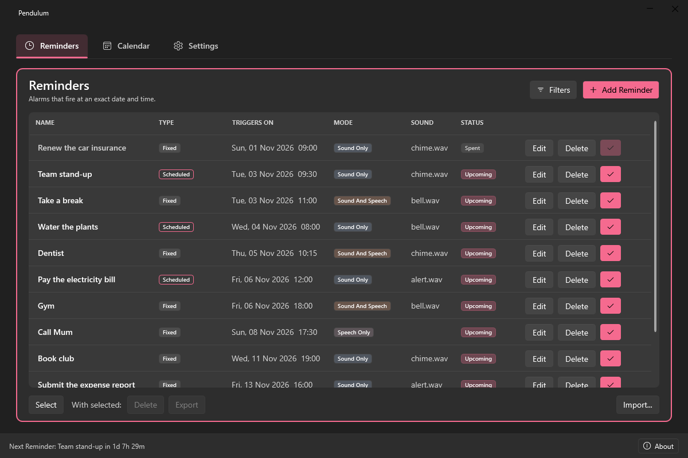
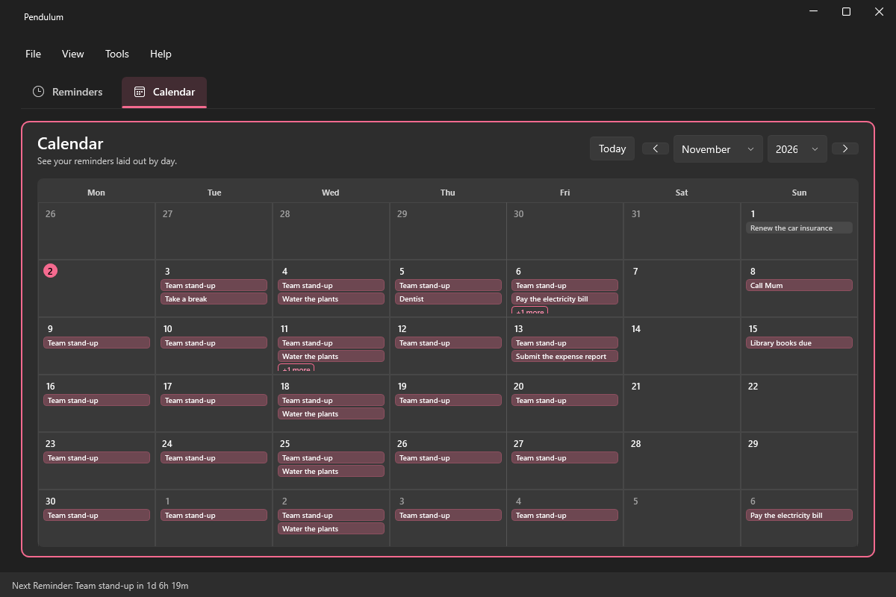
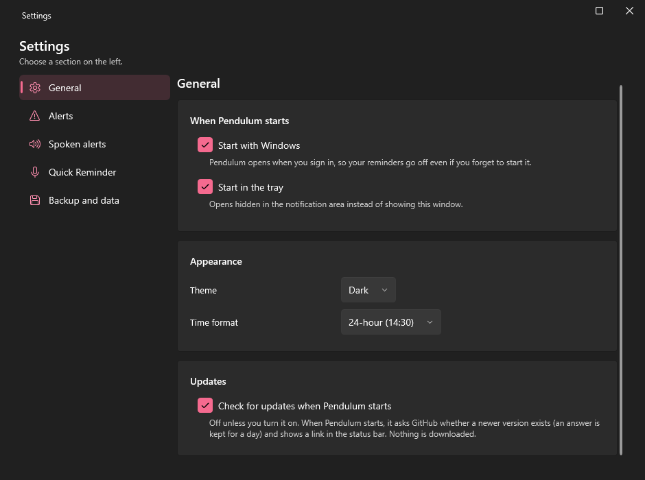
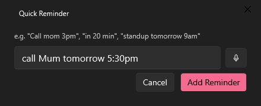
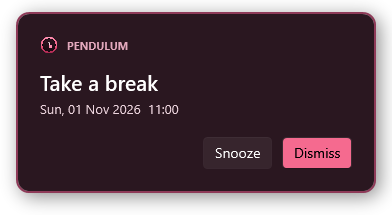

<p align="center"></p>

# Pendulum

[](https://github.com/Suremise/Pendulum/actions/workflows/ci.yml)

A tray-resident Windows desktop timer and alarm utility. Pendulum stays out of the way in the system tray and surfaces alerts as a topmost popup with sound and/or spoken-phrase notifications, even while you're working in another window.

<p align="center">
  
  
  
</p>

<table align="center">
  <tr>
    <td align="center">
      <br/>
      <sub>Ctrl+Shift+R anywhere, type or speak it — "call mom 3pm", "in 20 min" — and it's scheduled.</sub>
    </td>
    <td align="center">
      <br/>
      <sub>When it comes due: a small topmost popup, sound and/or spoken phrase, one click to snooze or dismiss.</sub>
    </td>
  </tr>
</table>

## Features

- **Reminders** — alarms set for an exact date and time, with sound, text-to-speech, or both. Supports Outlook-style recurrence (daily/weekly/monthly/yearly), bulk select/delete/export, and reminders-only or whole-app backup & restore.
- **Calendar** — a month view of every reminder, with navigable months/years and click-to-edit on any reminder shown on it.
- **Settings** — sound library management, speech-to-text (Windows or a locally-run Whisper model) for the Quick Reminder mic button, text-to-speech (Windows or a locally-run Piper voice), alert style, snooze duration, an auto-resolve timeout for unanswered alerts, 12/24-hour time format, and launch-on-startup.
- **Tray integration** — minimizes to the system tray instead of closing; the tray icon's tooltip shows the next upcoming reminder.
- **Resilient by design** — reminders that come due while the app is closed, or that go unanswered, resolve themselves sensibly (reschedule if recurring, mark spent otherwise) instead of getting stuck.

## Languages

Pendulum is in English. Every word it shows comes from `Pendulum.App/Resources/Strings.resx` (and
`Pendulum.Core/Resources/CoreStrings.resx` for the repeat descriptions), so it's ready to be
translated: a translation is a copy of those files for a language, as `Strings.fr.resx`. Dates and
times already follow your Windows region and the 12/24-hour setting. Quick Reminder's typed and
spoken phrases ("call mom 3pm", "in 20 min") stay English: they're a grammar Pendulum understands,
not labels to translate.

## Getting Pendulum

Download the latest `PendulumSetup-<version>.exe` from the [Releases](https://github.com/Suremise/Pendulum/releases) page — self-contained (no separate .NET install required), installs per-user (no admin/UAC prompt), adds a Start Menu entry and optional desktop shortcut, and registers a normal uninstaller. See [CHANGELOG.md](CHANGELOG.md) for what's new in each version.

## Building from source

Requires the [.NET 10 SDK](https://dotnet.microsoft.com/download) (`global.json` pins the version).

```
dotnet build Pendulum.sln -c Release
```

Produces a self-contained win-x64 build at `Pendulum.App\bin\Release\net10.0-windows\win-x64\`. This is the fast day-to-day dev loop — use `-c Debug` while iterating.

To cut a distributable release:

```
.\build-installer.ps1    # -> installer\Output\PendulumSetup-<version>.exe (requires Inno Setup 6)
```

## Project structure

- **Pendulum.App** — WPF UI (WPF-UI Fluent design), MVVM via CommunityToolkit.Mvvm, tray icon via H.NotifyIcon.
- **Pendulum.Core** — models, the timer engine, recurrence calculation, audio (NAudio) and speech (System.Speech/SAPI5) services, and JSON persistence. No UI dependencies.

## Data model

The installer places everything under `%LocalAppData%\Programs\Pendulum` (no admin/UAC
prompt needed, unlike a `Program Files` install) — but the important part isn't *where*
that is, it's that the exe and its data aren't split apart. There's no separate roaming
profile data folder and no registry use beyond the one opt-in "Launch on Windows startup"
toggle (a single `Run` key); the app's data always lives right next to whichever copy of
the exe is running it, dev build or installed:

```
Pendulum.exe
Data\
  settings.json
  triggers.json
  WhisperModels\   (Whisper ggml models, downloaded separately — see Settings)
  PiperModels\     (Piper engine + voice models, downloaded separately — see Settings)
Sounds\
  chime.wav, bell.wav, ...
```

## Privacy

Pendulum has no telemetry and no account. It goes online for one thing only, and only if you
turn it on: **Settings > General > Check for updates on startup** (off for new installs; if you
had it on before, it stays on).

- **What it sends:** one HTTPS request to GitHub's API,
  `GET https://api.github.com/repos/Suremise/Pendulum/releases/latest`, with the user agent
  `Pendulum/1` and nothing else that identifies you or your computer. GitHub sees your IP
  address, as with any web request.
- **How often:** only when Pendulum starts. A successful answer is kept in
  `Data\settings.json` for a day, so starts within that day send nothing. A check that fails
  (you're offline, or GitHub doesn't answer within 5 seconds or answers with an error) is
  dropped silently and tried again at the next start.
- **What it does with the answer:** if a newer version exists, a link appears in the status
  bar. Pendulum never downloads or installs anything itself.

The Whisper and Piper speech engines and voices are never downloaded by Pendulum: the buttons
in Settings open their download pages in your browser, and you put the files in
`Data\WhisperModels\` or `Data\PiperModels\` yourself. Speech is then processed entirely on your
computer.

## License

Pendulum is released under the [MIT License](LICENSE). © 2026 Darren Marshall.

## Third-party software

Built on open-source libraries, all MIT, and on .NET, which Pendulum carries with it. Two small
Microsoft files that come inside .NET, and the installer's Inno Setup, are under their own
permissive terms. [THIRD-PARTY-NOTICES.md](THIRD-PARTY-NOTICES.md) lists everything that ships,
with every licence in full.

The optional Whisper and Piper speech engines, models and voices aren't included: Settings links
to them, each with its licence. Piper's Windows download includes eSpeak NG, which is GPL-3.0;
Pendulum runs Piper as a separate program. Only voices whose terms let anyone use them are
offered.
